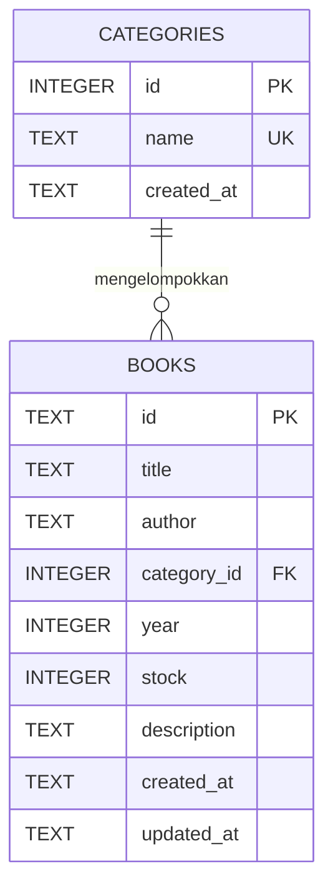

# ERD PustakaKu

## Diagram

## Relasi dan aturan data

- Satu kategori dapat memiliki nol atau banyak buku.
- Setiap buku harus memiliki tepat satu kategori.
- Nama kategori unik tanpa membedakan huruf besar dan kecil.
- ID buku berupa UUID teks; ID kategori berupa integer otomatis.
- Stok adalah bilangan bulat minimal 0: nilai 0 berarti habis, nilai di atas 0 berarti tersedia.
- Tahun terbit minimal 1450; API membatasi tahun maksimum sampai tahun berjalan.
- Penghapusan kategori yang masih dipakai buku ditolak oleh foreign key.

## API

- `GET /api/buku` — mengambil semua buku; mendukung pencarian opsional dengan `?search=`.
- `POST /api/buku` — memvalidasi dan menyimpan buku baru.
- `GET /api/buku/[id]` — mengambil detail buku berdasarkan ID.

## Lokasi database

- Skema: `pustakaku/database/schema.sql`
- File SQLite: `pustakaku/data/pustakaku.db`
- Inisialisasi dan query: `pustakaku/lib/db.ts`

Database dan kategori contoh dibuat otomatis saat API pertama kali digunakan.
